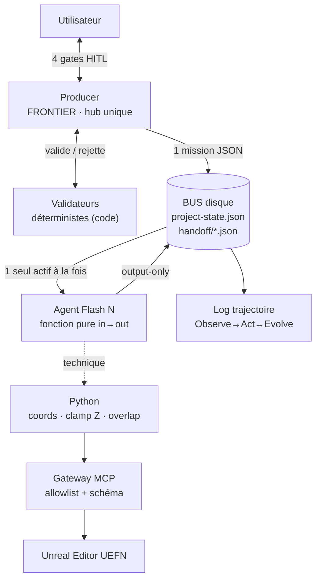

# Système Multi-Agents UEFN — Documentation

> Studio automatisé de création de maps Fortnite (UEFN) pour l'**Epic AI Megajam 2026**
> (12–16 nov. 2026). **1 Chef d'orchestre** sur modèle Frontier + **20 spécialistes**
> sur modèles Flash, pilotant Unreal Editor via un pont **MCP/Python**, sur un PC
> **16 Go** (donc exécution **séquentielle**, un seul agent actif à la fois).
>
> Cette documentation synthétise l'architecture et les règles de paramétrage,
> **dérivées des 5 White Papers Google « Agents »** (voir `02-principes-whitepaper.md`
> pour les citations page par page).

---

## L'idée en une phrase

**Hub-and-spoke** (un seul Supervisor) **+ assembly line séquentielle** **+ filesystem-as-bus** :
les 20 agents ne se parlent jamais entre eux, tout passe par le Producer, et la mémoire
du système vit **sur le disque** (fichiers JSON), pas dans les contextes des modèles.

---

## Carte des documents

| # | Fichier | Contenu |
|---|---|---|
| 00 | `README.md` | Ce fichier — index & vue d'ensemble |
| 01 | [`multi_agent_systeme.md`](./multi_agent_systeme.md) | **Architecture** — les 6 couches du système |
| 02 | [`02-principes-whitepaper.md`](./02-principes-whitepaper.md) | **Fondements** — ce que disent les White Papers Google, cité page par page + ce qui est une adaptation maison |
| 03 | [`03-parametrage-agents.md`](./03-parametrage-agents.md) | **Paramétrage** — quoi donner à chaque agent, comment, avec exemples |
| 04 | [`04-contrat-handoff.md`](./04-contrat-handoff.md) | **Contrat de handoff** — le JSON qui circule sur le bus (`uefn.handoff.v1`) |
| 05 | [`05-securite-mcp.md`](./05-securite-mcp.md) | **Sécurité MCP** — anti-hallucination, validateurs, gates HITL |

### Diagrammes
- [`diagram_fonctionnement.svg`](./diagram_fonctionnement.svg) — topologie (rendu)
- [`diagram_fonctionnement.mermaid`](./diagram_fonctionnement.mermaid) — source éditable
- [`../../agent-team/ARCHITECTURE-diagram.html`](../../agent-team/ARCHITECTURE-diagram.html) — vue complète enrichie (6 panneaux, code couleur par pôle)

### Templates réutilisables
- [`templates/TEMPLATE-fiche-agent.md`](./templates/TEMPLATE-fiche-agent.md) — squelette de paramétrage d'un agent (variantes Design & Technique)
- [`templates/handoff.schema.json`](./templates/handoff.schema.json) — JSON Schema machine-readable du contrat

### Fichiers liés (hors de ce dossier)
- [`../../agent-team/Producer_Orchestrator/Producer_Orchestrator.md`](../../agent-team/Producer_Orchestrator/Producer_Orchestrator.md) — spec fonctionnelle v0.4 du Chef
- [`../../agent-team/Producer_Orchestrator/Producer_Orchestrator.system-prompt-v0.5.md`](../../agent-team/Producer_Orchestrator/Producer_Orchestrator.system-prompt-v0.5.md) — prompt système opérationnel v0.5 (overlay Whitepaper)

---

## Les 21 agents (rappel)

**Chef (1)** — `00_Producer_Orchestrator` (Frontier).

**Pôle Design — hors UEFN (9)** : `Creative_Director`, `Game_Designer`, `System_Designer`,
`Economy_Designer`, `Mission_Content_Designer`, `Narrative_Designer`, `Writer_Scenariste`,
`UX_UI_Designer`, `Level_Designer`.

**Pôle Technique — UEFN / MCP / Verse (7)** : `Engine_Programmer`, `Lead_Tech_Director`,
`Gameplay_Programmer`, `AI_Programmer`, `UI_Programmer`, `Graphics_Programmer`,
`Physics_Programmer`.

**Pôle Audio & Voix (4)** : `Audio_Director`, `Composer`, `Sound_Designer`, `Voice_Designer`.

---

## Les 5 règles non-négociables

1. **Un seul hub.** Aucun agent ne parle à un autre en direct — tout transite par le
   Producer et par des fichiers (bus). *(WP1 p.17/p.48, WP3 p.18, WP4 p.20)*
2. **Un seul agent actif à la fois.** Contrainte RAM 16 Go + pattern Sequential. *(WP1 p.25)*
3. **Le LLM ne calcule jamais une coordonnée 3D.** Tout passe par Python. *(WP2 p.9)*
4. **La validation est du code, pas le modèle.** Un Flash ne vérifie jamais son propre JSON. *(WP4 p.20)*
5. **4 gates humains** : brief, GDD, archi technique, et avant toute écriture destructrice
   dans Unreal. *(WP1 p.26, WP2 p.36/p.43, WP5 p.14/p.18)*

---

## Honnêteté sur les sources

Les **principes** viennent des White Papers Google (cités précisément dans `02`). En
revanche, le **schéma `uefn.handoff.v1`**, le **budget « 4000 tokens »**, le **cap
d'itérations par phase** et le **cooldown « 15 s »** sont des **adaptations maison**
aux contraintes du studio — pas des normes littérales de Google. Chaque fichier distingue
clairement `[source Google]` de `[adaptation maison]`.
